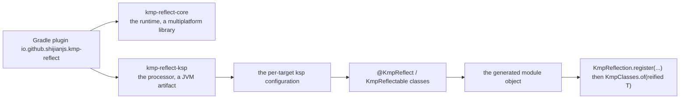

# Getting started

## Gradle setup

The library is three artifacts: the runtime (`kmp-reflect-core`, a multiplatform library), the
processor (`kmp-reflect-ksp`, a plain JVM artifact that KSP loads inside the compiler) and a Gradle
plugin (`io.github.shijianjs.kmp-reflect`) that wires the processor into every target.

```kotlin title="build.gradle.kts"
plugins {
    kotlin("multiplatform")
    id("com.google.devtools.ksp")
    id("io.github.shijianjs.kmp-reflect")
}

kotlin {
    jvm()
    js { nodejs() }
    wasmJs { nodejs() }
    mingwX64()   // pick the native target your build host can link

    sourceSets {
        commonMain.dependencies {
            implementation("io.github.shijianjs:kmp-reflect-core:<version>")
        }
    }
}

kmpReflect {
    // where<package>:<ObjectName> — becomes `object DemoReflection : KmpReflectModule`
    registry.set("com.example.demo:DemoReflection")
    module.set("demo")
}
```

That is the whole wiring. The plugin adds the processor to every declared target's `ksp<Target>`
configuration — KSP 2 has no catch-all, so a multiplatform build would otherwise repeat that line per
target — uses the processor version matching its own, and forwards the options to the processor.

`<version>` is the release you want, for example `0.1.0`. The artifacts are published to Maven Central
under the `io.github.shijianjs` group.

### Without the plugin

The plugin is a convenience, not a requirement: everything it does can be written by hand.

```kotlin
dependencies {
    // KSP runs once per target, so every target that compiles generated sources needs the processor.
    kotlin.targets
        .filter { it.name != "metadata" }
        .forEach { target ->
            add("ksp${target.name.replaceFirstChar { it.uppercaseChar() }}",
                "io.github.shijianjs:kmp-reflect-ksp:<version>")
        }
}

ksp {
    arg("kmp.reflect.registry", "com.example.demo:DemoReflection")
    arg("kmp.reflect.module", "demo")
    // Resource directories are read at compile time, so the processor has to know about them.
    arg("kmp.reflect.resources", layout.projectDirectory.dir("data").asFile.absolutePath)
}
```

Doing it by hand also means declaring the resource directories as inputs of the KSP tasks, otherwise
editing a resource leaves the previous content compiled in; the plugin does that for you.



## Opting a class in

Two ways, and they can be mixed:

```kotlin
@KmpReflect                       // annotation, with per-class options
class Person(val name: String)

object Toolbox : KmpReflectable   // marker interface, no options
```

Both are honoured only for `public` declarations (and, with the default `kmp.reflect.visibility = all`,
also `internal`) in the current module. `private` and `protected` members are never reflected: the
generated metadata is a top-level file outside the class, so a call to either there would not compile.
A nested class is reflected only when it is opted in itself; a companion object is always pulled in
with its class. `@KmpReflectIgnore` removes a single member — a function or property — from an
otherwise reflected class.

## Registering the generated module

The processor writes one metadata file per class plus one **module object** that lists them, named by
`kmpReflect.registry` above.

```kotlin
KmpReflection.register(DemoReflection)

val personClass = KmpClasses.of<Person>()
```

## Using it

```kotlin
val personClass = KmpClasses.of<Person>()

personClass.properties.map { it.name }              // [name, age, greeting]
personClass.function("greet", 1)?.isInvokable       // true

val instance = personClass.constructor(3)?.new("Ada", 36, "hidden")
personClass.function("greet", 1)?.invoke(instance, "Hi")   // "Hi, Ada!"
```

Arguments are passed as `Any?` and cast inside the generated lambda, so the declared types still apply:
passing a wrong type fails with a `ClassCastException` at the call site, exactly like `Method.invoke`.

## Other KSP options

| Option | Meaning |
| --- | --- |
| `kmp.reflect.registry` | `package:ObjectName` of the generated module object. Without it, no registry is written. |
| `kmp.reflect.module` | The name reported by `DemoReflection.module`. Defaults to the Kotlin module name. |
| `kmp.reflect.resources` | Directories to inline as resources, separated by commas, semicolons or the path separator. See [Inlined resources](resources.md). |
| `kmp.reflect.visibility` | `all` (default) or `public`: `public` drops everything that is not `public`, whatever the annotation says. |

A project with several modules registers several module objects, and each module carries its own
`kmp.reflect.registry`. Registration order does not matter; a later registration replaces an earlier
one with the same qualified name.
