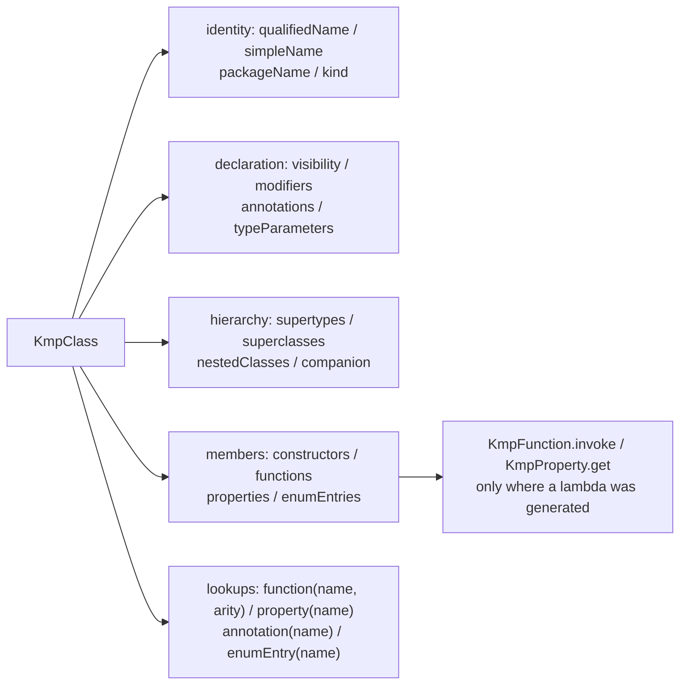

# Metadata

Generated metadata is plain data. Nothing is loaded, and every object is immutable.

## `KmpClass`

| Property | Meaning |
| --- | --- |
| `qualifiedName`, `simpleName`, `packageName` | Names as written in source, nested classes separated by `.` |
| `kind` | `CLASS`, `INTERFACE`, `OBJECT`, `COMPANION_OBJECT`, `ENUM_CLASS`, `ANNOTATION_CLASS` |
| `visibility`, `modifiers` | `KmpVisibility` and a set of `KmpModifier` (`DATA`, `OPEN`, `SEALED`, …) |
| `annotations` | `List<KmpAnnotation>` written on the declaration |
| `typeParameters` | `KmpTypeParameter` with bounds and nullability |
| `supertypes` | Directly declared supertypes; not transitive |
| `superclasses` | Directly declared supertypes that were reflected in the same module, linked to their metadata; `allSuperclasses` walks the chain |
| `constructors`, `functions`, `properties` | Declared members, `@KmpReflectIgnore` members removed |
| `enumEntries` | `KmpEnumEntry` with name, ordinal, annotations, and the instance itself |
| `companion`, `nestedClasses` | Only the ones that were reflected themselves |
| `objectInstance` | The singleton for an `object` or companion, `null` otherwise |
| `kclass` | The runtime class the processor recorded, `null` for hand-built metadata |

Its conveniences are lookups rather than scans: `function(name, arity)`, `functionsNamed(name)`,
`property(name)`, `constructor(arity)`, `enumEntry(name)`, `annotation(qualifiedName)`,
`annotationOf<A>()`, plus `isInterface`, `isObject`, `isEnum`, `isAbstract`, `isData`, `isProxyable`
and `isInstance(value)`.



## Functions and invocation

```kotlin
val greet = personClass.function("greet", 1) ?: return
greet.parameters.map { "${it.name}: ${it.type.simpleName}" }   // [prefix: String]
greet.isInvokable                                              // true
greet.invoke(person, "Hello")                                  // "Hello, Ada!"
greet.invokeAs<String>(person, "Hello")
```

`isInvokable` is `false` for a member whose call the processor cannot write as a plain Kotlin
expression:

- functions whose signature mentions a type parameter (`fun <T> identity(value: T): T`);
- members inherited from a supertype that is not reflected itself.

Such members are still described — name, parameters, return type, annotations — so you can display
them; they just refuse to run and throw `KmpReflectException` with a reason.

Arguments are positional, defaults are not applied: every parameter has to be passed. `vararg`
parameters take an `Array` of the element type.

## `suspend` functions

A `suspend` function is described like any other and is callable, but only from inside a coroutine:

```kotlin
val slowAdd = calculatorClass.function("slowAdd", 2) ?: return
slowAdd.isSuspend          // true
slowAdd.invokeSuspend(calculator, 3, 4)    // 7, from a `suspend` context
```

`invoke` refuses it (`KmpReflectException`) because the generated lambda carries the `suspend`
modifier — there is no synchronous call to make. `invokeSuspend` can only be called from a coroutine,
so the caller keeps control of scope and cancellation; the library never starts a coroutine of its own.
`suspend` is part of the standard library's function types, so this adds no dependency.

## Properties

`KmpProperty` carries `name`, `type`, `isMutable`, `modifiers`, `annotations`, `isReadable`,
`isWritable`, and `get`/`set` lambdas.

- A property whose type mentions a type parameter is not readable.
- A `var` with a `private set` is readable but not writable — the generated code could not assign it.
- Extension properties are not reflected.

## Types

`KmpTypeRef` is a name plus shape, not a `KType`:

```kotlin
class KmpTypeRef(
    val qualifiedName: String,
    val simpleName: String,
    val kind: KmpTypeKind,
    val nullable: Boolean,
    val arguments: List<KmpTypeRef>,
    val variance: KmpVariance,
    val kclass: KClass<*>?,
)
```

Generic arguments survive because they were written in the source. Erasure does not apply to
`isInstance`: `List<String>` accepts any list, exactly as reflection would.

## Annotations

```kotlin
val record = personClass.annotation("com.example.demo.Record") ?: return
record.string("name")          // "person"
record.get("priority")         // 3
record.kclass("type")          // KClass<*>?
record.annotation("nested")    // KmpAnnotation?
```

Values are stored as their real types: `String`, `Int`, `Long`, `Boolean`, `Char`, `KClass`, an enum
instance, a `KmpAnnotation`, or a `List<Any?>` for array members. A value the generator cannot express
(say an unsigned literal) is recorded as `null` and reported as a compiler warning rather than
silently dropped.

Two scans build on that: `KmpClasses.annotatedWith(qualifiedName)` — or the reified
`annotatedWith<A>()` on the JVM — and `KmpClasses.implementing(qualifiedName)`, which walks the
supertype chain of registered classes, including supertypes that were never reflected.

## Which classes are visible

Only classes whose module object was registered. That is the design: no classpath walking, no
accidental retention, and on Kotlin/JS nothing to walk in the first place. Register in tests and
remember that `KmpClasses.clear()` exists.
