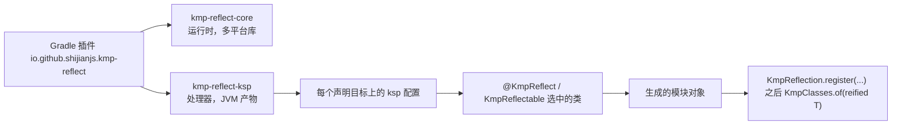

# 开始使用

## Gradle 配置

本库由三个产物组成：运行时 `kmp-reflect-core`（多平台库）、处理器 `kmp-reflect-ksp`（纯 JVM 产物，
由 KSP 在编译器进程里加载），以及把处理器接进每个目标的 Gradle 插件 `io.github.shijianjs.kmp-reflect`。

```kotlin title="build.gradle.kts"
plugins {
    kotlin("multiplatform")
    id("com.google.devtools.ksp")
    id("io.github.shijianjs.kmp-reflect")
}

kotlin {
    jvm()
    js { nodejs() }
    wasmJs { nodejs() }
    mingwX64()   // 换成你的构建宿主能链接的 native 目标

    sourceSets {
        commonMain.dependencies {
            implementation("io.github.shijianjs:kmp-reflect-core:<version>")
        }
    }
}

kmpReflect {
    // 包名:对象名 —— 生成 `object DemoReflection : KmpReflectModule`
    registry.set("com.example.demo:DemoReflection")
    module.set("demo")
}
```

接线就到这里。插件会给每个已声明的目标各加一次处理器到 `ksp<目标>` 配置（KSP 2 没有 catch-all，
否则多平台工程得按目标逐行重复），版本跟插件自身的版本对齐，并把选项转给处理器。

`<version>` 换成你需要的版本，例如 `0.1.0`。产物发布在 Maven Central 的 `io.github.shijianjs` 组下。

### 不用插件

插件只是省事，不是必需：它做的事都能手写。

```kotlin
dependencies {
    // KSP 按目标分别运行：每个编译生成源码的目标都要注册处理器。
    kotlin.targets
        .filter { it.name != "metadata" }
        .forEach { target ->
            add("ksp${target.name.replaceFirstChar { it.uppercaseChar() }}",
                "io.github.shijianjs:kmp-reflect-ksp:<version>")
        }
}

ksp {
    arg("kmp.reflect.registry", "com.example.demo:DemoReflection")
    arg("kmp.reflect.module", "demo")
    // 资源目录在编译期读取，得让处理器知道它在哪。
    arg("kmp.reflect.resources", layout.projectDirectory.dir("data").asFile.absolutePath)
}
```

手写就得自己把资源目录声明成 KSP 任务的输入，否则改了资源还是编译进旧内容；插件替你做了这件事。



## 让一个类参与反射

两种方式，可以混用：

```kotlin
@KmpReflect                       // 注解，带类级选项
class Person(val name: String)

object Toolbox : KmpReflectable   // 标记接口，没有选项
```

只对当前模块里的 `public` 声明生效（默认的 `kmp.reflect.visibility = all` 也包含 `internal`）。
`private` 与 `protected` 成员永远不进元数据：生成的元数据是类外的顶层文件，在里面调用它们无法编译。
嵌套类必须自己声明参与；伴生对象会随所属类一起被反射。`@KmpReflectIgnore` 可以把单个函数或属性从
已反射的类里去掉。

## 注册生成的模块对象

处理器为每个类生成一个元数据文件，外加一个把它们汇总起来的**模块对象**，名字由上面的
`kmpReflect.registry` 指定。

启动时注册一次。之后所有查找与扫描只能看到注册过的内容：

```kotlin
KmpReflection.register(DemoReflection)

val personClass = KmpClasses.of<Person>()
```

## 使用

```kotlin
val personClass = KmpClasses.of<Person>()

personClass.properties.map { it.name }              // [name, age, greeting]
personClass.function("greet", 1)?.isInvokable       // true

val instance = personClass.constructor(3)?.new("Ada", 36)    // secret 用默认值
personClass.function("greet", 1)?.invoke(instance, "Hi")   // "Hi, Ada!"
```

参数以 `Any?` 传入，在生成的 lambda 里转型，因此声明的类型仍然有效：类型不对会在调用处抛
`ClassCastException`，与 `Method.invoke` 一致。

## 其他 KSP 选项

| 选项 | 含义 |
| --- | --- |
| `kmp.reflect.registry` | 生成模块对象的 `包名:对象名`。不给则不生成 registry。 |
| `kmp.reflect.module` | `DemoReflection.module` 报告的名字，默认取 Kotlin 模块名。 |
| `kmp.reflect.resources` | 需要内联的资源目录，用逗号、分号或路径分隔符分隔。见[内联资源](resources.md)。 |
| `kmp.reflect.visibility` | `all`（默认）或 `public`：后者丢弃所有非 `public` 声明，与注解无关。 |

多模块项目可以有多个模块对象，各自带自己的 `kmp.reflect.registry`。注册顺序无所谓；同名类以后注册的为准。
