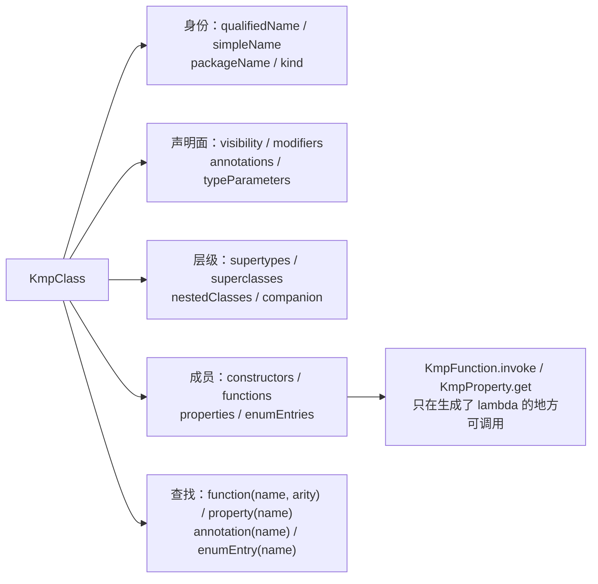

# 元数据

生成的元数据就是普通数据：不加载任何东西，每个对象都是不可变的。

## `KmpClass`

| 属性 | 含义 |
| --- | --- |
| `qualifiedName`、`simpleName`、`packageName` | 源码里的名字，嵌套类用 `.` 分隔 |
| `kind` | `CLASS`、`INTERFACE`、`OBJECT`、`COMPANION_OBJECT`、`ENUM_CLASS`、`ANNOTATION_CLASS` |
| `visibility`、`modifiers` | `KmpVisibility` 与 `KmpModifier` 集合（`DATA`、`OPEN`、`SEALED` 等） |
| `annotations` | 写在声明上的 `List<KmpAnnotation>` |
| `typeParameters` | `KmpTypeParameter`，含上界与可空性 |
| `supertypes` | 直接声明的父类型，不含传递闭包 |
| `superclasses` | 直接声明且在同一模块内参与反射的父类型，带元数据链接；`allSuperclasses` 沿链上溯 |
| `constructors`、`functions`、`properties` | 已声明的成员，`@KmpReflectIgnore` 的已移除 |
| `enumEntries` | `KmpEnumEntry`，含名称、序号、注解与实例本身 |
| `companion`、`nestedClasses` | 只有同样参与反射的才会出现 |
| `objectInstance` | `object` 或伴生对象的单例，其余为 `null` |
| `kclass` | 处理器记录的运行时类；手工构造的元数据为 `null` |

它的便捷方法都是按名字查找而不是扫描：`function(name, arity)`、`functionsNamed(name)`、
`property(name)`、`constructor(arity)`、`enumEntry(name)`、`annotation(qualifiedName)`、
`annotationOf<A>()`，以及 `isInterface`、`isObject`、`isEnum`、`isAbstract`、`isData`、`isProxyable`
和 `isInstance(value)`。



## 函数与调用

```kotlin
val greet = personClass.function("greet", 1) ?: return
greet.parameters.map { "${it.name}: ${it.type.simpleName}" }   // [prefix: String]
greet.isInvokable                                              // true
greet.invoke(person, "Hello")                                  // "Hello, Ada!"
greet.invokeAs<String>(person, "Hello")
```

当处理器无法把调用写成普通 Kotlin 表达式时，`isInvokable` 为 `false`：

- 签名里含类型参数的函数（`fun <T> identity(value: T): T`）；
- 从自身未参与反射的父类型继承来的成员。

这些成员仍会被描述（名称、参数、返回类型、注解），因此可以用于展示；调用时会抛出
`KmpReflectException` 并给出原因。

参数按位置传，**尾部连续**声明了默认值的参数可以省略：`greet(prefix: String = "Hello")` 既能
`greet()` 也能 `greet("Hi")`。默认值出现在参数表中间并不会缩短它——`format(value: Int, mode: String = "-", unit: String)`
仍然要传三个，因为按位置调用跳不过 `mode`。`vararg` 参数传入元素类型的 `Array`。

成员自带 `visibility`（`PUBLIC` 或 `INTERNAL`）。`private` / `protected` 成员不会出现在元数据里，
也不是“只描述不调用”：生成文件在类外，调用它们无法编译。

## `suspend` 函数

`suspend` 函数和普通函数一样被描述，也能调用，但只能在协程里调：

```kotlin
val slowAdd = calculatorClass.function("slowAdd", 2) ?: return
slowAdd.isSuspend          // true
slowAdd.invokeSuspend(calculator, 3, 4)    // 在 `suspend` 上下文中得到 7
```

`invoke` 会拒绝它（抛 `KmpReflectException`），因为生成的 lambda 带 `suspend` 修饰，没有可执行的同步
调用。`invokeSuspend` 只能在协程里调用，scope 与取消权仍归调用方，本库不会自己启动协程。
`suspend` 属于标准库的函数类型，因此不引入任何依赖。

## 属性

`KmpProperty` 带有 `name`、`type`、`isMutable`、`modifiers`、`annotations`、`visibility`、
`isReadable`、`isWritable` 以及 `get`/`set` lambda。

- 类型含类型参数的属性不可读。
- `var` 但 setter 为 `private` 时可读不可写 —— 生成的代码无法赋值。
- 扩展属性不参与反射。

## 类型

`KmpTypeRef` 是“名字 + 形状”，不是 `KType`：

```kotlin
class KmpTypeRef(
    val qualifiedName: String,
    val simpleName: String,
    val kind: KmpTypeKind,
    val nullable: Boolean,
    val arguments: List<KmpTypeRef>,
    val variance: KmpVariance,
    val kclass: KClass<*>?,
)
```

泛型实参之所以保留，是因为它们写在源码里。`isInstance` 不受类型擦除影响：`List<String>` 接受任何
列表，与反射行为一致。

## 注解

```kotlin
val record = personClass.annotation("com.example.demo.Record") ?: return
record.string("name")          // "person"
record.get("priority")         // 3
record.kclass("type")          // KClass<*>?
record.annotation("nested")    // KmpAnnotation?
```

值按真实类型存放：`String`、`Int`、`Long`、`Boolean`、`Char`、`KClass`、枚举实例、`KmpAnnotation`，
数组实参则是 `List<Any?>`。生成器无法表达的值（例如无符号字面量）记为 `null` 并给出编译警告，不会被
静默丢弃。

在此基础上提供两种扫描：`KmpClasses.annotatedWith(qualifiedName)`（JVM 上还有 reified 版
`annotatedWith<A>()`）与 `KmpClasses.implementing(qualifiedName)` —— 后者沿已注册类的父类型链上溯，
未参与反射的父类型也能按名字匹配。

## 哪些类可见

只有注册过模块对象的类。这是刻意的：不遍历 classpath、不会意外持有实例，Kotlin/JS 上本来也无处可遍历。
测试里记得注册，并且知道有 `KmpClasses.clear()` 可用。
