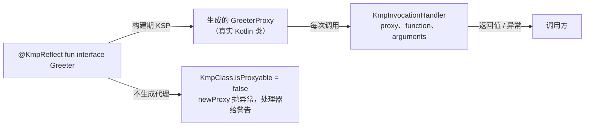

# 动态代理

JVM 的 `Proxy.newProxyInstance` 在别的目标上不存在。这里的做法是让处理器直接写一个接口实现类 ——
一段和你代码一起编译的真实 Kotlin 类。

## 生成条件

以下条件**全部**满足时才会生成代理：

- 接口本身参与反射（`@KmpReflect` 或 `KmpReflectable`）；
- 至少有 1 个抽象函数；
- **完全没有**属性，连具体属性也不行；
- 所有抽象成员都声明在该接口自身，不是从父类型继承来的；
- 没有 `suspend` 成员，也没有涉及类型参数的成员。

任一条件不满足就不会生成代理类、`KmpClass.isProxyable` 为 `false`、`newProxy` 抛出
`KmpReflectException`，同时处理器会打印一条说明原因的警告。


代理是编译出来的，不是反射出来的：在没有 `Proxy.newProxyInstance` 的目标上，调用照样走一个被编译器检查过的类。

## 用法

```kotlin
@KmpReflect
fun interface Greeter {
    fun greet(name: String): String
}
```

```kotlin
val handler = KmpInvocationHandler { proxy, function, arguments ->
    "hello, ${arguments.first()}"
}

val greeter = KmpClasses.of<Greeter>().newProxy(handler) as Greeter
greeter.greet("world")      // "hello, world"
```

`KmpProxy.create<Greeter> { _, function, args -> … }` 等价，省掉一次查找。

handler 收到的参数：

| 参数 | 含义 |
| --- | --- |
| `proxy` | 代理实例本身，便于 `equals`/`toString` 之类的自引用 |
| `function` | 该调用对应的 `KmpFunction`，带完整元数据 |
| `arguments` | 按位置传入的实参，已转成声明类型 |

返回值会被转成声明返回类型；`Unit` 函数忽略返回值。类型不对，或非空返回类型给了 `null`，会在调用处
失败 —— 代理不替你吞掉这类错误。

## 它不是

- 不是子类工厂：只实现接口，且只覆盖元数据描述了的成员。
- 不是有状态的：代理只持有 handler 与反射类，其余状态放在 handler 的闭包里。
- 不是 mock 框架：没有打桩、校验、参数匹配器。它只是机制，上层框架由你决定要不要搭。
- 不是预热的：调用 `newProxy` 之前不创建任何实例。
